# Model, Provider & Subscription Correlation Matrix & Update SOP

> **Target Site**: [https://apipricecheck.com](https://apipricecheck.com)  
> **Source Repository**: `jackiesparrow11/apipricecheck`  
> **Automated Verification**: `bun run verify` (`scripts/verify-pricing-integrity.ts`)

---

## 1. System Architecture & Data Flow

```mermaid
flowchart TD
    subgraph Data_Layer ["Data Layer (Single Source of Truth)"]
        M["src/data/models.json\n(210 Canonical Models & 336 Hosting Offers)"]
        P["src/data/providers.ts\n(13 Creators, 12 Hosts/Aggregators)"]
        S["src/data/subscriptions.ts\n(9 SaaS AI Subscriptions, 31 Plans)"]
    end

    subgraph Script_Layer ["Validation & Verification"]
        V["scripts/verify-pricing-integrity.ts\n(Schema & FK Integrity, Impact Graph)"]
        C["scripts/enrich-canonical-models.ts\n(Enrichment & Price Baseline)"]
    end

    subgraph Presentation_Layer ["Static Route Generation (Astro SSG)"]
        R1["Home Page: /\n(PricingTable, Stats, Quick Calc)"]
        R2["Provider Pages: /pricing/[provider]/\n(13 Creator Hubs, FAQs, Specs)"]
        R3["Leaderboard: /cheapest-llm-api/\n(Budget, Mid, Flagship, Reasoning)"]
        R4["Token Calculator: /calculators/token-cost/\n(Preact Interactive Simulator)"]
        R5["Subscriptions Hub: /subscriptions/\n(SubscriptionMatrix, Plan Filter)"]
        R6["Subscription Guides: /subscriptions/[service]/\n(9 Dedicated Guide Pages)"]
        R7["API Endpoint: /api/pricing.json\n(Machine-readable export)"]
        R8["SEO Feed: /sitemap.xml\n(29 Generated XML URLs)"]
    end

    M --> V
    P --> V
    S --> V

    M --> R1 & R2 & R3 & R4 & R7
    P --> R1 & R2 & R8
    S --> R5 & R6 & R8
    M -.bundled in.-> R6
```



---

## 2. Model-Provider-Subscription Correlation Matrix

### 2.1 Entity Relationship Overview

| Entity Category | Definition | Key Source File | Examples |
| :--- | :--- | :--- | :--- |
| **Model Creator (Lab)** | Foundation model research organization | `src/data/providers.ts` (`type: 'creator'`) | OpenAI, Anthropic, Google, DeepSeek, xAI, Meta, Alibaba, Zhipu, Moonshot, MiniMax, Mistral, Cohere, Perplexity |
| **Canonical Model** | Unique foundation model identity & official rate | `src/data/models.json` (`ModelRecord`) | `claude-3-7-sonnet`, `deepseek-r1`, `gpt-4o`, `gemini-2.0-flash` |
| **Hosting Offer (Relay/Cloud)** | Secondary inference cloud or aggregator price | `models.json` (`hostingOffers[]`) | AWS Bedrock, Azure AI, Groq, Cerebras, DeepInfra, Together AI, Novita, OpenRouter |
| **Subscription Service** | Fixed-fee consumer or team SaaS plan | `src/data/subscriptions.ts` (`SubscriptionService`) | ChatGPT Plus/Pro, Claude Pro/Max, Gemini Advanced, Cursor Pro, DeepSeek Web |

---

### 2.2 Change Impact & Dependency Matrix

When an entity is updated in the database, the following pages, components, and SEO schemas are directly affected:

| Trigger / Update Event | Database File | Affected Pages & Routes | Affected Components | SEO Schemas Affected |
| :--- | :--- | :--- | :--- | :--- |
| **Model Price Updated** (e.g. DeepSeek V3 drop or Claude caching discount) | `models.json` (`officialPricing`) | • `/`<br>• `/pricing/[provider]/`<br>• `/cheapest-llm-api/`<br>• `/calculators/token-cost/`<br>• `/api/pricing.json`<br>• `/sitemap.xml` | • `PricingTable.tsx`<br>• `TokenCalculator.tsx`<br>• `Calculator.tsx`<br>• `QuickAnswerBox.astro`<br>• `FaqSection.astro` | `Product`<br>`AggregateOffer`<br>`FAQPage` |
| **New Model Added** (e.g. GPT-5 or Claude 4.0 launch) | `models.json`<br>`providers.ts` | • `/`<br>• `/pricing/[provider]/`<br>• `/cheapest-llm-api/`<br>• `/calculators/token-cost/`<br>• `/api/pricing.json`<br>• `/sitemap.xml` (new URL if new creator) | • `PricingTable.tsx`<br>• `Header.astro` (if mainstream)<br>• Leaderboard rankings | `ItemList`<br>`Product`<br>`BreadcrumbList` |
| **Hosting Offer Added / Updated** (e.g. Groq 500 t/s rate change) | `models.json` (`hostingOffers[]`) | • `/`<br>• `/pricing/[provider]/`<br>• `/calculators/token-cost/`<br>• `/api/pricing.json` | • `PricingTable.tsx` (Drawer & discount tag)<br>• `Calculator.tsx` (Savings calculation) | `AggregateOffer` (lowest available price) |
| **Subscription Plan / Tier Changed** (e.g. Claude Max launch or Cursor price change) | `subscriptions.ts` (`plans[]`) | • `/subscriptions/`<br>• `/subscriptions/[service]/`<br>• `/sitemap.xml` | • `SubscriptionMatrix.tsx`<br>• Service tier breakdown cards<br>• "API vs Sub" advice block | `Product`<br>`FAQPage`<br>`BreadcrumbList` |
| **Model Deprecated or Retired** | `models.json` (`status: 'deprecated'`) | • `/`<br>• `/pricing/[provider]/`<br>• `/cheapest-llm-api/` | Filtered out of active rankings and default calculator selection | `Product` (`availability: Discontinued`) |

---

### 2.3 Mainstream Model to Subscription Mapping

| Canonical Model ID | Model Name | Primary Creator | Bundled in Subscription Tiers |
| :--- | :--- | :--- | :--- |
| `claude-3-7-sonnet` | Claude 3.7 Sonnet | Anthropic | Claude Pro, Claude Max (5x/20x), Claude Team, Cursor Pro, Cursor Business |
| `claude-3-5-haiku` | Claude 3.5 Haiku | Anthropic | Claude Free, Claude Pro, Claude Team |
| `claude-3-opus` | Claude 3 Opus | Anthropic | Claude Pro, Claude Team |
| `gpt-4o` | GPT-4o | OpenAI | ChatGPT Plus, ChatGPT Pro, ChatGPT Team, Cursor Pro, Cursor Business |
| `gpt-4o-mini` | GPT-4o mini | OpenAI | ChatGPT Free, Cursor Hobby |
| `o1` | OpenAI o1 | OpenAI | ChatGPT Plus, ChatGPT Pro, Cursor Business |
| `o3-mini` | OpenAI o3-mini | OpenAI | ChatGPT Plus, ChatGPT Team, Cursor Pro, Cursor Business |
| `gemini-2.0-flash` | Gemini 2.0 Flash | Google | Gemini Free, Google AI Plus, Google AI Pro |
| `gemini-1.5-pro` | Gemini 1.5 Pro | Google | Google AI Plus, Google AI Pro (Advanced) |
| `gemini-2.0-pro` | Gemini 2.0 Pro | Google | Google AI Pro (Advanced), Google AI Ultra |
| `deepseek-v3` | DeepSeek V3 | DeepSeek | DeepSeek Web & App (Free), DeepSeek Pay-As-You-Go API |
| `deepseek-r1` | DeepSeek R1 | DeepSeek | DeepSeek Web & App (Deep Think Free), DeepSeek Pay-As-You-Go API |
| `grok-2` | Grok 2 | xAI | Grok Free, SuperGrok (X Premium+) |
| `grok-3` | Grok 3 | xAI | SuperGrok (X Premium+), SuperGrok Heavy |
| `glm-4-plus` | GLM-4-Plus | Zhipu AI | GLM Coding Pro, GLM Coding Max |
| `glm-4-flash` | GLM-4-Flash | Zhipu AI | GLM Free |
| `kimi-1.5` | Moonshot Kimi 1.5 | Moonshot AI | Kimi+ VIP, Kimi Research Turbo |
| `minimax-01` | MiniMax-01 | MiniMax | MiniMax Developer Portal |

---

## 3. Standard Operating Procedures (Execution SOP)

### SOP-01: Adding a New AI Model

1. **Verify Creator Slug**:
   Ensure `creator` matches an existing ID in `src/data/providers.ts` (e.g. `openai`, `anthropic`, `google`, `deepseek`, `xai`, `meta`, `alibaba`, `zhipu`, `moonshot`, `minimax`, `mistral`, `cohere`, `perplexity`).
   *If launching a brand-new Lab, first add the definition in `src/data/providers.ts`.*

2. **Add Entry to `src/data/models.json`**:
   Follow the strict schema:
   ```json
   {
     "id": "model-unique-slug",
     "name": "Display Model Name",
     "family": "Creator Family",
     "creator": "creator-id",
     "creatorName": "Creator Name (Label)",
     "provider": "creator-id",
     "providerName": "Direct API Provider",
     "contextWindow": 128000,
     "maxOutputTokens": 8192,
     "description": "Clear 1-sentence value proposition.",
     "tier": "Budget" | "Mid" | "Flagship" | "Reasoning",
     "isFlagship": true | false,
     "isCheapestInTier": true | false,
     "officialPricing": {
       "inputPerM": 1.00,
       "cachedInputPerM": 0.25,
       "outputPerM": 3.00
     },
     "hostingOffers": [
       {
         "hostId": "openrouter",
         "hostName": "OpenRouter",
         "hostType": "aggregator",
         "inputPerM": 1.00,
         "outputPerM": 3.00,
         "status": "active",
         "outboundUrl": "https://openrouter.ai/provider/model-slug"
       }
     ],
     "status": "active",
     "releasedAt": "YYYY-MM-DD",
     "lastVerifiedAt": "YYYY-MM-DD"
   }
   ```

3. **Link to Subscription (if applicable)**:
   If this model is included in a consumer subscription (e.g. ChatGPT, Claude, Cursor), add its exact name to `includedModels` in `src/data/subscriptions.ts`.

4. **Run Verification Script**:
   ```bash
   bun run verify
   bun run scripts/verify-pricing-integrity.ts --inspect model-unique-slug
   ```

5. **Build & Verify Static Output**:
   ```bash
   bun run build
   ```

---

### SOP-02: Updating Model Pricing

1. **Locate Target Model**:
   Open `src/data/models.json` and search by `id`.

2. **Update Price Fields**:
   - `officialPricing.inputPerM`: Price per 1 Million input prompt tokens (USD).
   - `officialPricing.cachedInputPerM`: Prompt caching hit rate per 1M tokens (USD).
   - `officialPricing.outputPerM`: Price per 1 Million completion tokens (USD).
   - `lastVerifiedAt`: Update to today's date (`YYYY-MM-DD`).

3. **Check Tier Rankings**:
   - If the model became the cheapest in its category, update `"isCheapestInTier": true`.
   - Ensure other models in the tier have their flags adjusted accordingly.

4. **Execute Verification**:
   ```bash
   bun run scripts/verify-pricing-integrity.ts --inspect <model-id>
   ```
   *Review the list of affected pages to confirm all target routes are captured.*

---

### SOP-03: Updating Hosting / Relay Offers

1. **Locate Canonical Model** in `src/data/models.json`.
2. **Update or Push to `hostingOffers`**:
   - `hostId`: Must match cataloged host in `providers.ts` (`groq`, `cerebras`, `deepinfra`, `together`, `novita`, `openrouter`, `aws-bedrock`, `azure`, etc.).
   - `tokensPerSec`: Include if hardware accelerator benchmark is available (e.g. Groq 300 t/s, Cerebras 1800 t/s).
   - `inputPerM` / `outputPerM`: Specific host rates.
   - `outboundUrl`: Direct landing or console link.
3. **Run Verification**:
   ```bash
   bun run verify
   ```

---

### SOP-04: Updating Subscription Plans

1. **Open `src/data/subscriptions.ts`**.
2. **Locate Service** (`chatgpt`, `claude`, `gemini`, `grok`, `glm`, `kimi`, `deepseek`, `cursor`, `seedance`).
3. **Update Plan Properties**:
   - `priceMonthly` / `priceYearly`.
   - `rateLimits` (e.g. "50 messages per 3 hours on Claude 3.7 Sonnet").
   - `includedModels`: Array of model names.
   - `subVsApiAdvice`: Updated guidance on monthly breakeven thresholds.
4. **Run Verification**:
   ```bash
   bun run verify
   ```

---

### SOP-05: Pre-Flight Check & Deployment

Always follow this 4-step deployment checklist:

```bash
# 1. Run schema and correlation integrity check
bun run verify

# 2. Inspect impact graph for changed model (example: deepseek-r1)
bun run scripts/verify-pricing-integrity.ts --inspect deepseek-r1

# 3. Compile full static site across all 29 routes
bun run build

# 4. Commit and push to remote repository (Cloudflare Pages auto-deploys)
git add .
git commit -m "data: update pricing and models correlation matrix"
git push origin main
```

---

## 4. Verification Script Command Reference

The verification script (`scripts/verify-pricing-integrity.ts`) is designed to run locally and in GitHub Actions CI:

| Command | Purpose |
| :--- | :--- |
| `bun run verify` | Complete integrity check across models, providers, hosting offers, and subscriptions. |
| `bun run scripts/verify-pricing-integrity.ts --inspect <model-id>` | Prints the specific impact graph (all pages regenerated when `<model-id>` changes). |
| `bun run scripts/verify-pricing-integrity.ts --strict` | Strict mode (fails with exit code 1 if any warning is triggered). |

---

## 5. Summary of System Assets

- **Total Models**: 210 canonical and benchmark models
- **Total Creators (Labs)**: 13 foundation research organizations
- **Total Hosting & Relay Offers**: 336 offers across Groq, Cerebras, DeepInfra, Together, Novita, OpenRouter, AWS Bedrock, Azure
- **Total Monitored Subscriptions**: 9 consumer/enterprise services (31 plans)
- **Total Static Generated Routes**: 29 URLs
- **Automated Verification**: `bun run verify` (0 errors, 100% PASS)
