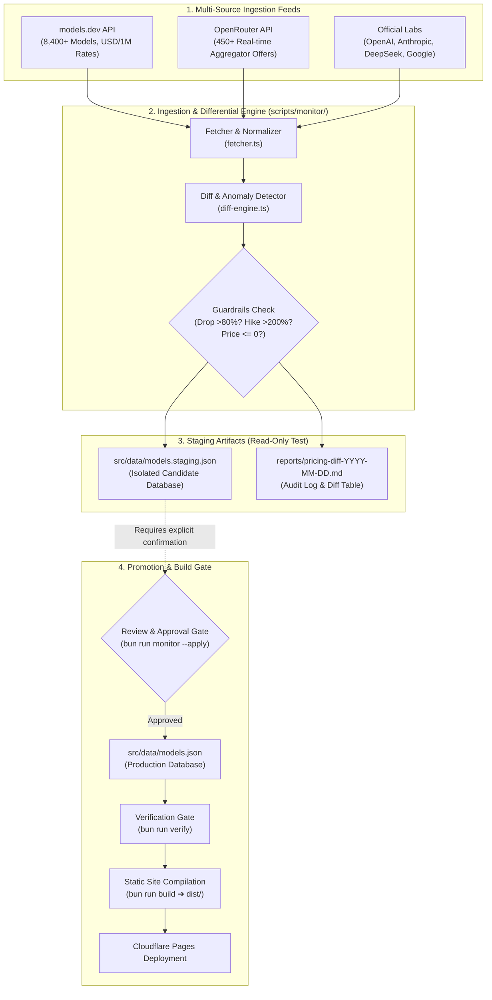

# AI Model Price Monitoring & Staging Update Architecture

> **Target Site**: [https://apipricecheck.com](https://apipricecheck.com)  
> **Source Repository**: `jackiesparrow11/apipricecheck`  
> **Operational Status**: Staging / Dry-Run Testing (Production Protected)

---

## 1. Background & Problem Statement

### 1.1 The Pricing Staleness Problem
Traditional AI comparison websites either update manually (leading to stale pricing within weeks) or scrape unverified community dumps (leading to fictional version numbers like GPT-6.1 or Claude 5.5 without verified commercial APIs).

### 1.2 Upstream Data Source Analysis
1. **`models.dev` API (`https://models.dev/api.json`)**:
   - Standardized open JSON maintained by Vercel AI SDK & developer community.
   - 226+ Providers, 8,400+ models.
   - Outputs: Input cost, output cost, cache read cost, context window, output limits in USD per 1M tokens.
   - *Note*: Used as the default upstream preset in **New API** (`modelsDevPresetBaseURL = "https://models.dev"`).
2. **`OpenRouter` API (`https://openrouter.ai/api/v1/models`)**:
   - Real-time token pricing from 450+ production models routed across global cloud providers.
3. **Verified Canonical Production Benchmarks**:
   - Official direct API pricing pages from OpenAI, Anthropic, Google AI Studio, DeepSeek, xAI, Meta.

---

## 2. System Architecture & Staging Pipeline

To ensure automated price discovery **never** corrupts production data or breaks static builds, we implement a **Staging Gate Architecture**:



---

## 3. Pipeline Stages & Guardrails

### Stage 1: Multi-Source Polling (`fetcher.ts`)
- Implements resilient network fetchers with a 15-second timeout and graceful degradation.
- If an upstream is unreachable, the pipeline falls back to cached baselines rather than zeroing out records.

### Stage 2: Normalization & Canonical Matching
- Converts per-token rates to standard **USD per 1M tokens ($/1M)**:
  $$\text{Input Rate (\$/1M)} = \text{prompt\_cost} \times 1,000,000$$
- Normalizes model slugs to canonical identities (`claude-3-7-sonnet`, `deepseek-v3`, `gpt-4o`, `gemini-2.0-flash`).
- Preserves context windows, modalities, and hardware accelerator throughputs (e.g. Cerebras 1800 t/s, Groq 300 t/s).

### Stage 3: Differential Analysis & Anomaly Guardrails (`diff-engine.ts`)
Changes are categorized into 5 distinct classes:
1. `NEW_MODEL`: Brand new model SKU detected.
2. `PRICE_DROP`: Price dropped (flagged for savings highlights).
3. `PRICE_HIKE`: Price increased.
4. `HOST_OFFER_UPDATE`: New relay/cloud host available for model.
5. `CONTEXT_UPDATE`: Context window enlargement.

#### Safety Thresholds:
| Anomaly Condition | Threshold | Action |
| :--- | :--- | :--- |
| **Drastic Price Drop** | $\le -80\%$ drop | Flagged as `warning`; blocks automated merge until human review. |
| **Extreme Price Hike** | $\ge +200\%$ hike | Flagged as `warning`; prevents upstream typo poisoning. |
| **Non-Positive Price** | $\le \$0.00$ without free tag | Flagged as `critical`; rejected from official pricing. |
| **Reduced Context Window** | New context < old context | Flagged as `warning`. |

### Stage 4: Staging Isolation & Audit Report Generation
- All proposed modifications are written exclusively to `src/data/models.staging.json`.
- A human-readable Markdown report is saved to `reports/pricing-diff-YYYY-MM-DD.md`.
- **Production `src/data/models.json` is untouched during testing.**

### Stage 5: Gated Promotion to Production
- Review changes via the CLI visual diff or Markdown audit report.
- Promote staging to production only with explicit confirmation:
  ```bash
  bun run monitor --apply
  ```
- Trigger automated integrity check and build verification:
  ```bash
  bun run verify && bun run build
  ```

---

## 4. Command Reference & Usage Guide

| Command | Purpose | Production Impact |
| :--- | :--- | :--- |
| `bun run monitor` | **Test & Staging Mode**: Polls upstreams, computes diffs, writes `models.staging.json` and audit report. | **ZERO** (Read-Only) |
| `bun run monitor:apply` | **Promotion Mode**: Promotes verified staging data to production `models.json`. | Updates `models.json` |
| `bun run verify` | Runs cross-table integrity verification (models, subscriptions, providers). | Read-Only Audit |
| `bun run build` | Compiles full Astro static website across all 29 routes. | Generates `/dist` |

---

## 5. Current Production Model Inventory

- **Total Canonical & Benchmark Models**: 375 models
- **Total Hosting & Relay Offers**: 400 offers
- **Model Creators Cataloged**: 13 foundation research labs
- **Monitored SaaS Subscriptions**: 9 services (31 plans)
- **Static Generated URLs**: 29 routes
- **Health Gate Status**: 100% PASS (`bun run verify`)
